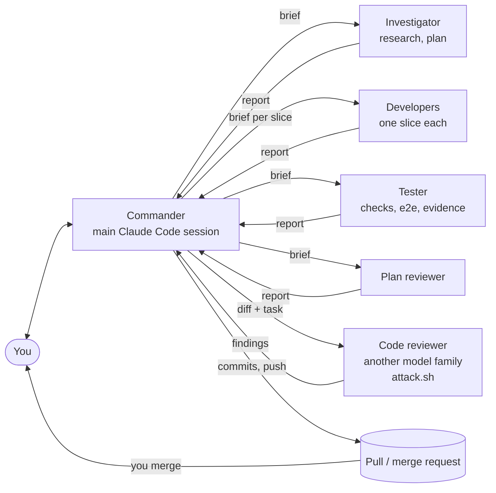

# How the waw plugin works

This document is for people who install and use waw. It explains what the plugin puts on
your machine, who does what during a task, how the workers are isolated and supervised, how
models are chosen, and where the time and the money go. Installing, updating and removing
the plugin are covered in the [root README](../../README.md) and the
[plugin README](../../plugins/waw/README.md). Each slash command, step by step, is in
[SKILLS.md](SKILLS.md).

## 1. In one picture

You talk to one Claude Code session only: the **commander**. It understands the request,
asks you what only you can decide, plans the work and hands it out to **workers**: separate,
sandboxed Claude Code or Codex sessions, each in a role (investigator, developer, reviewer,
tester) and each on the model and route you picked with `/configure`. The commander checks
every result, commits, has the code reviewed by a model of another family, and opens the
pull request. You read the plan before the work, the report after it, and you merge.



## 2. The parts

What the plugin installs, and what each part is for. `<config>` is `$CLAUDE_CONFIG_DIR`, by
default `~/.claude`.

| Part | Purpose |
|------|---------|
| Skills | The slash commands: `/configure`, `/ship`, `/auto-pilot`, `/brainstorm`, `/task-cost`, `/retro`. See [SKILLS.md](SKILLS.md). |
| Rules in `<config>/rules/waw/` | `commander.md` (how the main session commands), `git-delivery.md` (GitHub and GitLab delivery), and optionally `decisions.md` (what to ask you) and `jira-tickets.md` (read a Jira ticket with all its attachments). `/configure` copies them there; the session-start hook keeps the copies current, so do not edit them in place. |
| Hooks | A push guard on every Bash call (no merges, no force pushes, no pushes to the default branch), worktrees in `~/worktrees/<repo>/<name>`, and a short note at session start naming the models and routes. |
| Scripts on the PATH | `agent.sh` (start and talk to workers), `attack.sh` (code review and `/auto-pilot` decisions), `task.sh` (worktree, dependencies, time limit), `deliver.sh` (commit, push, pull request), `stage.sh` (time and cost per stage), `retro.sh` (history), `smoke.sh` (end-to-end check of the worker setup), `configure.sh` (the engine of `/configure`). |
| Status line | One line with the model, context use, plan limits, cost, branch, the number of running workers and whether the session is sandboxed. Optional, chosen in `/configure`. |
| Waw home `<config>/waw/` | `config` (models, routes, review providers), `workers/<route>/` (the config dir of each worker route), `prices.tsv` (gateway prices), `state/` (worker slots, session stages, status line figures, the ledger), `plugin` (a link to the installed version), `backups/` and `applied.json` (what `/configure` changed, for the uninstall). |

What changes on install and after `/configure` is listed in
[the plugin README](../../plugins/waw/README.md#what-changes-when-you-install-it).

## 3. Roles

| Role | Model setting | Does | Never |
|------|---------------|------|-------|
| Commander | this session | talks to you, decides, uses connectors (Jira, Slack, Google, Figma, ...), writes briefs, checks reports and diffs, commits, pushes, opens pull requests, publishes documents, makes a small exact fix | writes features, tests or configs |
| Investigator / planner | `AGENT_INVESTIGATOR_MODEL` | researches the code and the problem, finds how the project is checked, proposes the plan and its slices, drafts documents | changes code |
| Developer | `AGENT_DEVELOPER_MODEL` | implements one slice, tests first | commits, touches files outside its slice |
| Reviewer | `AGENT_REVIEWER_MODEL` for plans; the providers of `attack.sh` for code | reviews the plan (as a worker) and the code (one call through `attack.sh`) | changes anything |
| Tester | `AGENT_TESTER_MODEL` | runs the checks and the e2e tests, proves each acceptance criterion on the running product (device, browser, CLI), keeps evidence | changes product code |

A few things follow from this split:

- **The commander does not write code.** The one exception is a small exact fix: already
  stated exactly (by a review finding, a failing check or its own check of a diff), one
  file, about 20 changed lines at most, no new logic, not a test, a guarded file or a
  dependency, and no worker is changing that file. Even then a tester runs the tests, and
  the report lists it under "Edited by the commander".
- **Workers have no connectors.** When a task needs Jira, Confluence, Slack or Figma, the
  commander reads them and saves what matters as files in the run directory
  (`.ship/<slug>/context/`, `.ship/<slug>/attachments/`).
- **Every worker report is a claim.** Each role answers in a fixed JSON schema (a developer:
  `status`, `files_changed`, `tests_added`, `commands_run`, `concerns`,
  `out_of_scope_needs`, ...; a tester: `status`, `checks`, `criteria`, `bugs`,
  `not_covered`, `exclusions`, `e2e_proposal`), and the commander checks it against the code
  and the diff before accepting it.

**Why the code reviewer comes from another model family.** A model tends to miss the same
mistakes in review that it made while writing. The rule is that a worker model and the
reviewer of its code come from different families (for example a Claude developer and a GPT
reviewer). `/configure` proposes a setup that keeps them apart; choosing "Claude only" is
possible, at the price of a weaker review.

## 4. How a task flows

`/ship <task>` takes a task from your words (or an issue, a Jira key, a URL) to a pull
request. `/auto-pilot <task>` does the same while you are away. Both go through the same
stages; [SKILLS.md](SKILLS.md) describes each step.

| Stage | What happens |
|-------|--------------|
| workspace | A slug for the task, a branch named the way the project names branches, a new worktree, the run directory, dependencies installed from the lockfile in the background. |
| understand | The commander gathers context (connectors, the issue) and briefs the investigator, which reads the code and reports how things are now and how the project is checked. |
| ask | One round of questions, only those that are yours to decide (`decisions.md`). |
| plan | The investigator proposes slices; a plan reviewer checks them; you see a short plan and answer "ok" or correct it. This is the one planned stop. |
| build | Developers implement the slices, in parallel where they own disjoint files; the commander checks and commits each slice. |
| verify | A tester proves the criteria while a model of another family reviews the diff; real findings go back to developers. |
| deliver | The report becomes the pull request description; the commander pushes, opens the pull request, watches CI and reads the CI reviewer's comments. |

**One worktree per task.** `task.sh open` creates `~/worktrees/<repo>/<slug>` on a new
branch from `origin/<default branch>` (inside Orca, Orca creates the workspace instead). All
workers of the task share that worktree.

**The run directory** `.ship/<slug>/` holds everything about the task that is not code. It
is kept out of git (`task.sh dir` adds `.ship/` to the repository's exclude list) and is
never committed:

| Path | Content |
|------|---------|
| `prompt.md`, `task.md`, `questions.md` | the task as you gave it, the agreed task with acceptance criteria, the questions |
| `briefs/<name>.md` | the brief of each worker |
| `agents/` | per worker: the brief as sent, its whole session (`<name>.jsonl`), its report (`<name>.result.json`), stderr, its questions and approvals; `events.log` and `runs.tsv` for the whole run |
| `context/`, `attachments/` | what the commander gathered with connectors |
| `evidence/` | the tester's outputs and screenshots, and the host-run files |
| `review.md`, `security.md` | the output of the code review |
| `mr.md` | the report, which becomes the pull request description |

**Slices with disjoint files.** The plan splits the work into slices of about 300 changed
lines at most. Each slice lists the files it owns, and no file belongs to two slices; a
shared file (an index, a router, a types file) belongs to one slice, and the others wait for
it or get its interface in their brief. That is what lets several developers work in the
same worktree at once.

**Commits by the commander.** Workers never commit. After checking a developer's diff, the
commander commits exactly that slice's files with `deliver.sh commit`, which stages only the
named paths and runs git with hooks off (the project's hook checks run in the tester
instead). Commit messages and pull request texts carry no Claude attribution.

**One review round.** `attack.sh --role review` sends the diff and the task to the first
review provider that answers; in a risky area (authentication, secrets, money, outside
input, deleting or migrating data) also `--role security`. The commander checks every
finding against the code, sends the real ones to a developer and declines the rest in one
line. A second round happens only when the first found a blocker.

**The pull request.** `deliver.sh mr` pushes the branch and opens a pull request (GitHub)
or merge request (GitLab) with the report as its body. The commander then watches CI to the
end, fixes a red build (two rounds at most), and shows you the findings of an AI reviewer
that runs in CI, each with a verdict. You merge; the plugin never does.

**Host runs.** No worker sandbox can start Electron, Chromium or the iOS simulator
(Chromium needs a macOS permission the sandboxes do not grant, and `simctl` reaches no
simulator from inside one). A command that must start one of them, typically an end-to-end
or visual-capture run, is a **host run**: the commander runs it itself on your machine. A
command is a host run when the investigator marks it so (from the project's `AGENTS.md` /
`CLAUDE.md`, or its use of Playwright `_electron` or `simctl`), or when a tester reports
`blocked` with `needs host: <command>`. Before running it, the commander reads the whole
diff of the branch and every file the command runs that the diff does not show; anything
that reaches outside the test (network beyond localhost, keys, home files, a download) is
not run and becomes a finding. The output goes to `.ship/<slug>/evidence/host-<n>-<name>.txt`
with the command line, the device, the exit code and the processes left behind; a tester
then reads that evidence instead of running it again. The report lists each host run under
"Run on the host". This applies under `/auto-pilot` too.

**`/auto-pilot` differences.** It starts only when `agent.sh sandbox-check` passes. Your
questions and the plan go to a decider (the decide providers of `attack.sh`, never the model
that built the plan), the run has a time limit (see Limits), a step that could do harm is
left for you instead of taken, and the report starts with "Decided without you".

## 5. Talking to workers

Workers are not fire-and-forget. While they run, the commander follows
`agent.sh events .ship/<slug>/agents`, which prints one line for each event that needs it:

| Event | Meaning | What the commander does |
|-------|---------|-------------------------|
| `QUESTION` | A worker asks (with `ask.sh`) and waits up to 8 minutes. | Answers with `agent.sh answer <name> <qid> "<answer>"`; asks you first when the decision is yours. If the worker went on without an answer (`QUESTION-TIMEOUT`) and the answer differs from its recommendation, it steers the worker. |
| `APPROVAL` | A worker wants to edit a guarded file it was not granted; it waits up to 8 minutes, then it is denied. | Looks at the change and decides itself: `agent.sh approve <name> <aid>` when the task needs it and it is right, otherwise `agent.sh deny <name> <aid> "<reason>"`. A change that only turns a check green (a disabled rule, a loosened setting) is denied. |
| `BLOCKED` | A guard or a permission refused a call. | If the step is needed and belongs to the commander (git, an install, a connector), does it and steers the worker on; otherwise steers it to skip the step. Never steers it around the block. |
| `FAILING` | Three failed calls in a row. | Reads the log, then steers with a concrete correction, or stops and re-briefs. |
| `STALLED` | No step for 10 minutes. | The same. |
| `TIMEOUT` | The run hit its time limit. | Runs it again with a narrower brief, or splits the slice. |

The commander's tools for a running worker:

- `agent.sh steer <name> "<message>"` interrupts the worker and resumes its session with the
  message; it keeps its whole context. At most two steers per worker; after that it is
  stopped and briefed again.
- `agent.sh stop <name>` ends it now (status `stopped`).
- `agent.sh run ... --resume <session id> --name <name>-fix1` sends feedback on a finished
  report to the same worker, which keeps its context and costs less than a new one.

What you can look at yourself while a task runs:

- the background task of each worker: one line per step, such as
  `[dev-a 1m05s] Bash pnpm test`;
- `agent.sh ps`: every worker running now, with role, model, elapsed time, worktree and its
  last tool call (a queued one shows `WAITING FOR WORKER SLOT`);
- `agent.sh log <name>` (add `-f` to follow): the steps of one worker so far;
- the files of `.ship/<slug>/agents/`: briefs, sessions, reports, questions and approvals.

You can also just ask the commander how the workers are doing.

## 6. Isolation and safety

The plugin assumes a worker can make mistakes and limits what a mistake can reach. There
are two layers: an OS sandbox, which is the real isolation, and hooks that match command
text and stop accidents.

**The OS sandbox.** Every Bash command of a Claude Code worker runs in Claude Code's OS
sandbox (Seatbelt on macOS, bubblewrap on Linux); a Codex worker gets the same limits from
a Codex permission profile. A worker:

- writes only in its worktree, the run directory, the temp directory and the tool caches
  (`~/Library/Caches`, `~/.cache`);
- cannot read keys and tokens: `~/.ssh`, the keychain, `~/.npmrc`, `~/.aws`, `~/.config/gh`,
  `~/.config/glab-cli`, the Codex and opencode logins, shell histories, browser profiles,
  and the settings and logins of the worker routes themselves;
- reaches no network host but localhost (tests can still start servers); a worker started
  with `--allow-install` also reaches its package registries;
- uses its own git config without commit signing, and a private watchman state (Jest and
  Metro fall back to their node crawler).

If the sandbox is not available, the worker does not start without it. A sandbox refusal
("Operation not permitted", a blocked host) reaches the commander as `BLOCKED`. If the step
is needed and safe (a cache directory, a host the build must reach), the fix is a narrow
exception in the plugin itself, followed by its tests and `smoke.sh`, never a way around
the sandbox. `AGENT_SANDBOX=off` exists for debugging only; with it `/auto-pilot` refuses to
start.

**The hooks.**

- The **worker guard** (in every worker) blocks git that changes history, the index or the
  branch (commit, push, pull, fetch, merge, rebase, stash, reset, checkout, ...); pull or
  merge request and API writes with `gh`/`glab` (read-only `view`, `list`, `diff`,
  `status`, `checks` are allowed); package installs unless `--allow-install`; `rm` outside
  the worktree; and edits outside the worker's scope. The investigator and the tester may
  write only under `.ship/`.
- The **push guard** (in every session of your config, and in every worker) blocks
  `gh pr merge` and `glab mr merge`, any forced push, and a push to the default branch.

**Guarded files and `--grant`.** Projects can mark files as "ask first" (for example
`package.json`, `tsconfig.json`, lint, test and CI configs, `AGENTS.md`, `.claude/**`). When
a slice must change such a file, the plan you approve names it, and the commander passes
exactly that path to the developer with `--grant <path>`. Any other edit of a guarded file
becomes an `APPROVAL` event for the commander. Every decision is logged in
`agents/<name>.approvals.log`, and the report lists the guarded files that changed. Where a
project's settings disable `bypassPermissions`, workers run with `acceptEdits` and a fixed
list of allowed commands; the project's own deny and ask rules always apply.

**What the commander never runs on your machine.** Project code: tests, builds, lint,
package scripts, the project's git hooks. A tester runs them in the sandbox. The only
exception is a host run (section 4), after the diff has been read. Dependencies of a new
worktree are installed by `task.sh deps`, from the lockfile only (`pnpm install
--frozen-lockfile`, `npm ci`, `yarn --frozen-lockfile`), and only on the untouched task base.
Where a project denies installs to every agent, you run the one install command yourself;
the commander gives you the exact line.

**Delivery limits.** `deliver.sh` refuses:

- a detached HEAD, the default branch and protected branches (`main`, `master`, `develop`,
  `release/*`, `hotfix/*`, the project's own list, and the branches the forge protects);
- any force, except `deliver.sh push --force-with-lease` for the commander's own task branch
  after a rebase, with a lease pinned to the last fetch. On a branch someone else works on,
  or one an open pull request targets, the commander asks you first; under `/auto-pilot` it
  leaves that to you.

A refusal is final. The plugin never merges a pull or merge request, never changes remote
URLs or forge logins, and never creates branches or commits on the forge through its API.

**Secrets.** The key of a gateway route lives in the macOS keychain, under the item name
`/configure` gave it (`openrouter`, `nexos-ai`, `opencode-go`, or the route name). The
route's `apiKeyHelper` reads it when Claude Code needs it; the key never enters a worker's
environment: a worker starts from an empty environment (`env -i`) with a short allowlist of
variables. To store a new
key, copy it and run:

```sh
! security add-generic-password -U -s <item> -a waw -w "$(pbpaste)"
! pbcopy </dev/null
```

(The interactive `-w` prompt cuts a key at 128 characters, so it is not used.) `attack.sh`
does not send changed files with secret-like names (`.env*` except `.env.example`, keys,
credentials) to a review provider.

## 7. Models, routes and providers

All of this is set by `/configure`, which writes `<config>/waw/config`. Run it again to
change one part (`/configure developer model`, `/configure review only`).

- `AGENT_<ROLE>_MODEL`: the model of each worker role (`INVESTIGATOR`, `DEVELOPER`,
  `REVIEWER`, `TESTER`).
- `AGENT_<ROLE>_ROUTE`: how that model is reached. A route is a directory
  `<config>/waw/workers/<route>/`: for a Claude Code worker its config dir (endpoint and
  `apiKeyHelper` in `settings.json`), for a Codex worker its `CODEX_HOME`.
- `PROVIDERS` (with `<P>_MODEL` per provider): the providers of the code review and of the
  `/auto-pilot` decisions, tried in order; the first valid answer wins.

**Worker routes.**

| Route | What it is |
|-------|------------|
| `anthropic` | Claude models on your own account; the route needs its own login once (`CLAUDE_CONFIG_DIR='<dir>' claude auth login`). |
| `codex` (or `codex-<name>`) | GPT workers as Codex sessions on the ChatGPT subscription; the route needs its own Codex login once (`CODEX_HOME='<dir>' codex login`), separate from your `~/.codex`. |
| `opencode-go` | The OpenCode Go subscription through its Anthropic-compatible API (GLM, Kimi, DeepSeek, Qwen, MiniMax and others); its API key goes in the keychain. |
| `openrouter`, `nexos` (nexos.ai), `custom` | Pay-per-token gateways; `custom` is any other Anthropic-compatible URL. |

**Review providers.** `codex` (Codex CLI on a ChatGPT subscription), `opencode` (opencode
CLI with its own logins), `claude` (Claude Code on this session's login), `gateway` (an
OpenAI-compatible URL), or any worker route by name. The opencode CLI serves review and
decisions only; it cannot host workers.

`/configure` offers subscriptions you already pay for first (Codex/ChatGPT, a claude.ai
login, OpenCode Go, other opencode subscription logins) and pay-per-token routes after them.

**Codex workers and Claude workers.** The commander talks to both the same way (events,
answer, approve, steer, stop, `--resume`). A Codex worker gets the same role prompt, the same
report schema, the same guards and approvals, and an equivalent sandbox. Two differences:
it has no dollar budget (the subscription has none; `--timeout` bounds it, and reports show
its cost as `sub`), and it shares the ChatGPT plan's limits with your own Codex use.

**Fallback routes.** Codex cannot follow every project's Claude Code permission rules. When
it cannot, `agent.sh` says so and runs that role on its fallback:
`AGENT_<ROLE>_FALLBACK_ROUTE` (default `WORKER_ROUTE`, else `anthropic`) and
`AGENT_<ROLE>_FALLBACK_MODEL` (default `sonnet`). `/configure` asks for them when a role is
on `codex`.

**Skills of a worker.** A worker gets the project's skills and the `skills/` of its route
directory, not your personal skills.

**See what is set.** `agent.sh models` prints each role's model, route and config dir;
`attack.sh --check-config` validates the review config and prints the provider order and
models; the note at session start names both. `configure.sh check` verifies the whole setup
and prints the fix for each item still to do.

## 8. Limits

- **At most 5 workers at a time** on the machine (`AGENT_MAX_WORKERS`, shared by all
  sessions through `<config>/waw/state/`). A run holds a slot from the moment it starts until
  its worker exits. A run that finds no free slot waits; after 10 minutes
  (`AGENT_SLOT_WAIT_SECONDS`, default 600) it ends with `slot-timeout` (exit 7) and no model
  has run. `attack.sh` takes no slot.
- **Budgets.** Each run has a dollar budget in real US dollars at the model's price
  (`--budget`; defaults: developer 5, reviewer 4, tester 6, investigator 10). For gateway
  models the price comes from `prices.tsv`. Codex workers have no dollar budget.
- **Timeouts.** A worker run ends after 60 minutes by default (`--timeout <minutes>`), with a
  `TIMEOUT` event. A worker's question or approval waits up to 8 minutes. A worker with no
  step for 10 minutes raises `STALLED`. A review call has its own deadline (by default 600
  seconds plus a little per 1000 bytes of input, at most 2400 seconds; `ATTACK_TIMEOUT`).
- **The `/auto-pilot` time limit.** `task.sh limit start` writes a deadline of 500 minutes by
  default (an existing one is kept). The commander checks it before the plan, before each
  build wave, before verification and before the pull request. Past the deadline it starts
  no new workers, lets running ones finish, commits what is checked and delivers it as a
  draft pull request whose report starts with what is left.

## 9. Cost and history

- **The ledger** is `<config>/waw/state/ledger.jsonl` in the waw home, so it survives
  deleted worktrees and run directories. It gets one record when a worker run starts, one
  per event, and one when it ends (status, turns, seconds, tokens, cost, steers), plus the
  commander's stage marks with the session's cost so far.
- **`agent.sh report .ship/<slug>/agents`** sums the runs of one task per role and model:
  runs, failures, fix runs (names ending in `-fix<n>`), steering messages, turns, minutes,
  tokens, and the fix runs per developer slice.
- **`/task-cost`** shows the stages of the current task (`stage.sh report`: time, waits for
  you, cost and output tokens per stage) next to the worker report. Worker dollars are real:
  gateway prices from `prices.tsv`, not Claude Code's own estimate, which prices every
  gateway model at Opus rates. `~` marks an estimate, `n/a` a model with no price, `sub` a
  subscription run.
- **`/retro`** reads the ledger over a period (the last 7 days by default), a task or a
  project: runs per role and model, failures and interruptions, fix runs per slice, events
  and the most frequent `BLOCKED` texts, the commander's stages, the total cost. The runs of
  `smoke.sh` are kept apart.
- **The status line** shows the session's cost, time and lines changed, plan limits when
  Claude Code reports them, and `⚙ N workers` while workers run.

These numbers are also how a model change is judged: after a worker model changes, the
commander may propose relaxing one of the rules that compensate for weaker models (for
example larger slices) for three tasks, and compares fix runs, steering, review findings and
time with the tasks before.

## 10. Updating and checking the setup

The plugin updates like any Claude Code plugin; auto-update, manual update, pinning a
machine to a reviewed commit and rolling back are in the
[Update section of the plugin README](../../plugins/waw/README.md#update). On the first
session after an update, the plugin refreshes its rules in `<config>/rules/waw/` (a changed
rule may take one more session to apply) and keeps your config, routes and logins. After an
update of the plugin, and after Claude Code updates itself, run `smoke.sh` once before the
next task: it starts one real developer worker (on your developer route, a few cents, 1 to
3 minutes) in a throwaway repository and checks that the sandbox, the guard and the route
still work. `configure.sh check` verifies the configuration itself. Working on the plugin's
own code is described under
[Develop in the plugin README](../../plugins/waw/README.md#develop).

## 11. Glossary

- **Commander**: the main Claude Code session you talk to. It decides, briefs, checks,
  commits and delivers; it does not write code.
- **Worker**: a separate, sandboxed Claude Code or Codex session started by `agent.sh` in one
  role (investigator, developer, reviewer, tester) for one brief.
- **Slice**: one coherent part of a change, about 300 changed lines at most, that owns its
  files; one developer implements it.
- **Brief**: the complete written instruction a worker starts from: goal, context, files it
  may change, interfaces, tests, steps, commands, what not to do, and when it is done.
- **Run directory**: `.ship/<slug>/` in the task's worktree: briefs, worker sessions and
  reports, context, evidence, the review and the report. Never committed.
- **Worktree**: a separate checkout of the repository on the task's branch, in
  `~/worktrees/<repo>/<slug>`, shared by all workers of that task.
- **Route**: how a worker's model is reached: a config dir in `<config>/waw/workers/<route>/`
  (`anthropic`, `codex`, `opencode-go`, `openrouter`, `nexos`, a custom gateway).
- **Provider**: a model source for the one-shot code review and `/auto-pilot` decisions
  (`codex`, `opencode`, `claude`, `gateway`, or a route), tried in the order of `PROVIDERS`.
- **Host run**: a project command the commander runs on your machine because no sandbox can
  start Electron, Chromium or the iOS simulator; only after reading the diff, with its
  output kept as evidence.
- **Ledger**: `<config>/waw/state/ledger.jsonl`, the record of every worker run, event and
  stage, read by `/retro`.

## 12. See also

- [SKILLS.md](SKILLS.md): each slash command (`/configure`, `/ship`, `/auto-pilot`,
  `/brainstorm`, `/task-cost`, `/retro`) step by step.
- [Root README](../../README.md): install, trying it in a separate config dir.
- [Plugin README](../../plugins/waw/README.md): what you get, where things live, update,
  pinning, removal, worker runtimes.
