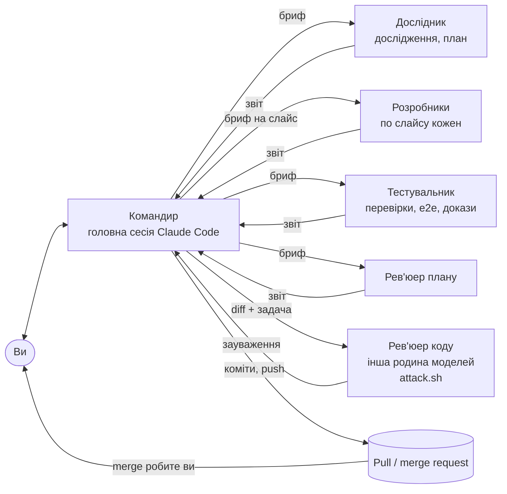

# Як працює плагін waw

Цей документ для тих, хто встановлює waw і користується ним. Тут пояснено, що плагін додає
на ваш комп'ютер, хто що робить під час задачі, як воркери ізольовані і як за ними
наглядають, як обираються моделі та куди йдуть час і гроші. Встановлення, оновлення і
видалення плагіна описано в [кореневому README](../../README.md) і
[README плагіна](../../plugins/waw/README.md). Кожна slash-команда крок за кроком описана в
[SKILLS.md](SKILLS.md).

## 1. Одним малюнком

Ви говорите лише з однією сесією Claude Code: з командиром (commander). Він
розбирається в запиті, питає вас лише про те, що можете вирішити тільки ви, планує роботу і
роздає її воркерам (workers): окремим сесіям Claude Code або Codex у пісочниці,
кожна у своїй ролі (investigator, developer, reviewer, tester) і на моделі та маршруті, які
ви обрали через `/configure`. Командир перевіряє кожен результат, робить коміти, віддає код
на рев'ю моделі іншої родини і відкриває pull request. Ви читаєте план до роботи, звіт після
неї і самі робите merge.



## 2. Складові

Що встановлює плагін і навіщо кожна частина. `<config>` означає `$CLAUDE_CONFIG_DIR`, за
замовчуванням `~/.claude`.

| Частина | Призначення |
|---------|-------------|
| Скіли | Slash-команди: `/configure`, `/ship`, `/auto-pilot`, `/brainstorm`, `/task-cost`, `/retro`. Див. [SKILLS.md](SKILLS.md). |
| Правила в `<config>/rules/waw/` | `commander.md` (як командує головна сесія), `git-delivery.md` (доставка на GitHub і GitLab) і, за бажанням, `decisions.md` (про що питати вас) та `jira-tickets.md` (читати тікет Jira з усіма вкладеннями). `/configure` копіює їх туди, а хук старту сесії тримає копії актуальними, тож не редагуйте їх на місці. |
| Хуки | Захист push на кожен виклик Bash (жодних merge, force push і push у гілку за замовчуванням), worktree у `~/worktrees/<repo>/<name>` і коротка нотатка на старті сесії з моделями та маршрутами. |
| Скрипти в PATH | `agent.sh` (запуск воркерів і розмова з ними), `attack.sh` (рев'ю коду і рішення `/auto-pilot`), `task.sh` (worktree, залежності, ліміт часу), `deliver.sh` (коміт, push, pull request), `stage.sh` (час і вартість по етапах), `retro.sh` (історія), `smoke.sh` (наскрізна перевірка налаштування воркерів), `configure.sh` (рушій `/configure`). |
| Рядок стану | Один рядок: модель, заповнення контексту, ліміти плану, вартість, гілка, кількість запущених воркерів і чи сесія в пісочниці. Необов'язковий, обирається в `/configure`. |
| Дім waw `<config>/waw/` | `config` (моделі, маршрути, провайдери рев'ю), `workers/<route>/` (каталог конфігурації кожного маршруту воркерів), `prices.tsv` (ціни шлюзів), `state/` (слоти воркерів, етапи сесій, цифри для рядка стану, журнал), `plugin` (посилання на встановлену версію), `backups/` і `applied.json` (що змінив `/configure`, для видалення). |

Що змінюється при встановленні і після `/configure`, перелічено в
[README плагіна](../../plugins/waw/README.md#what-changes-when-you-install-it).

## 3. Ролі

| Роль | Налаштування моделі | Робить | Ніколи не |
|------|---------------------|--------|-----------|
| Командир | ця сесія | говорить з вами, вирішує, користується конекторами (Jira, Slack, Google, Figma, ...), пише брифи, перевіряє звіти й diff, комітить, пушить, відкриває pull request, публікує документи, робить малу точну правку | пише функціональність, тести чи конфіги |
| Дослідник / планувальник (`investigator`) | `AGENT_INVESTIGATOR_MODEL` | досліджує код і проблему, з'ясовує, як проєкт перевіряють, пропонує план і слайси, готує чернетки документів | змінює код |
| Розробник (`developer`) | `AGENT_DEVELOPER_MODEL` | реалізує один слайс, спершу тести | комітить, чіпає файли поза своїм слайсом |
| Рев'юер (`reviewer`) | `AGENT_REVIEWER_MODEL` для планів; провайдери `attack.sh` для коду | рецензує план (як воркер) і код (один виклик через `attack.sh`) | змінює будь-що |
| Тестувальник (`tester`) | `AGENT_TESTER_MODEL` | запускає перевірки й e2e-тести, доводить кожен критерій приймання на працюючому продукті (пристрій, браузер, CLI), зберігає докази | змінює код продукту |

З цього розподілу випливає кілька речей:

- **Командир не пише код.** Єдиний виняток: мала точна правка. Вона вже точно сформульована
  (зауваженням рев'ю, впалою перевіркою або власною перевіркою diff), це один файл, щонайбільше
  близько 20 змінених рядків, без нової логіки, не тест, не захищений файл і не залежність, і
  жоден воркер зараз цей файл не змінює. Навіть тоді тести запускає тестувальник, а звіт
  згадує правку в розділі «Edited by the commander».
- **У воркерів немає конекторів.** Коли задача потребує Jira, Confluence, Slack чи Figma,
  командир читає їх сам і зберігає потрібне файлами в каталозі запуску
  (`.ship/<slug>/context/`, `.ship/<slug>/attachments/`).
- **Кожен звіт воркера — це твердження.** Кожна роль відповідає у фіксованій JSON-схемі
  (розробник: `status`, `files_changed`, `tests_added`, `commands_run`, `concerns`,
  `out_of_scope_needs`, ...; тестувальник: `status`, `checks`, `criteria`, `bugs`,
  `not_covered`, `exclusions`, `e2e_proposal`), і командир звіряє її з кодом і diff, перш ніж
  прийняти.

**Чому рев'юер коду з іншої родини моделей.** Модель на рев'ю схильна пропускати ті самі
помилки, яких припустилася, коли писала код. Тому правило таке: модель воркера і рев'юер її
коду мають бути з різних родин (наприклад, розробник Claude і рев'юер GPT). `/configure`
пропонує налаштування, де вони розведені; варіант «лише Claude» можливий, але рев'ю тоді
слабше.

## 4. Як проходить задача

`/ship <task>` веде задачу від ваших слів (або issue, ключа Jira, URL) до pull request.
`/auto-pilot <task>` робить те саме, поки вас немає. Обидві проходять ті самі етапи; кожен
крок описано в [SKILLS.md](SKILLS.md).

| Етап | Що відбувається |
|------|-----------------|
| workspace | Slug задачі, гілка з назвою за правилами проєкту, новий worktree, каталог запуску, залежності з lock-файлу ставляться у фоні. |
| understand | Командир збирає контекст (конектори, issue) і дає бриф досліднику, який читає код і звітує, як усе працює зараз і як проєкт перевіряють. |
| ask | Один раунд питань, лише тих, що вирішуєте ви (`decisions.md`). |
| plan | Дослідник пропонує слайси, рев'юер плану їх перевіряє, ви бачите короткий план і відповідаєте «ok» або виправляєте. Це єдина запланована зупинка. |
| build | Розробники реалізують слайси, паралельно там, де їхні файли не перетинаються; командир перевіряє і комітить кожен слайс. |
| verify | Тестувальник доводить критерії, а модель іншої родини тим часом рецензує diff; справжні зауваження повертаються розробникам. |
| deliver | Звіт стає описом pull request; командир пушить, відкриває pull request, стежить за CI і читає коментарі AI-рев'юера з CI. |

**Один worktree на задачу.** `task.sh open` створює `~/worktrees/<repo>/<slug>` на новій
гілці від `origin/<default branch>` (усередині Orca робочий простір створює Orca). Усі воркери
задачі працюють у цьому worktree.

**Каталог запуску** `.ship/<slug>/` містить усе про задачу, що не є кодом. Він поза git
(`task.sh dir` додає `.ship/` у exclude-список репозиторію) і ніколи не комітиться:

| Шлях | Вміст |
|------|-------|
| `prompt.md`, `task.md`, `questions.md` | задача у вашому формулюванні, погоджена задача з критеріями приймання, питання |
| `briefs/<name>.md` | бриф кожного воркера |
| `agents/` | на кожного воркера: надісланий бриф, уся його сесія (`<name>.jsonl`), звіт (`<name>.result.json`), stderr, його питання й запити на схвалення; `events.log` і `runs.tsv` на весь запуск |
| `context/`, `attachments/` | те, що командир зібрав конекторами |
| `evidence/` | виводи і скриншоти тестувальника, файли запусків на хості |
| `review.md`, `security.md` | результат рев'ю коду |
| `mr.md` | звіт, який стає описом pull request |

**Слайси з окремими файлами.** План ділить роботу на слайси, щонайбільше близько 300
змінених рядків кожен. Кожен слайс перелічує свої файли, і жоден файл не належить двом
слайсам; спільний файл (index, router, файл типів) належить одному слайсу, а інші чекають на
нього або отримують його інтерфейс у брифі. Саме це дозволяє кільком розробникам працювати в
одному worktree одночасно.

**Коміти робить командир.** Воркери ніколи не комітять. Перевіривши diff розробника,
командир комітить рівно файли цього слайсу через `deliver.sh commit`: він додає лише названі
шляхи і запускає git з вимкненими хуками (хук-перевірки проєкту натомість запускає
тестувальник). Повідомлення комітів і тексти pull request не містять атрибуції Claude.

**Один раунд рев'ю.** `attack.sh --role review` надсилає diff і задачу першому провайдеру
рев'ю, який відповість; у ризиковій зоні (автентифікація, секрети, гроші, зовнішні вхідні
дані, видалення чи міграція даних) також `--role security`. Командир звіряє кожне зауваження
з кодом, справжні передає розробнику, решту відхиляє одним рядком. Другий раунд буває лише
тоді, коли перший знайшов блокер.

**Pull request.** `deliver.sh mr` пушить гілку і відкриває pull request (GitHub) або merge
request (GitLab) зі звітом в описі. Далі командир стежить за CI до кінця, виправляє червону
збірку (щонайбільше два раунди) і показує вам зауваження AI-рев'юера, що працює в CI, кожне з
вердиктом. Merge робите ви; плагін — ніколи.

**Запуски на хості** (host run). Жодна пісочниця воркера не може запустити Electron,
Chromium чи симулятор iOS (Chromium потребує дозволу macOS, якого пісочниці не дають, а
`simctl` зсередини не бачить жодного симулятора). Команда, яка мусить запустити щось із
цього, зазвичай e2e або візуальне знімання, — це запуск на хості: командир запускає її сам
на вашому комп'ютері. Команда вважається такою, коли дослідник позначив її так (з `AGENTS.md`
/ `CLAUDE.md` проєкту або за використанням Playwright `_electron` чи `simctl`), або коли
тестувальник звітує `blocked` з `needs host: <command>`. Перед запуском командир читає весь
diff гілки і кожен файл, який запускає команда, але якого немає в diff; усе, що виходить за
межі тесту (мережа далі localhost, ключі, файли домашнього каталогу, завантаження), не
запускається і стає зауваженням. Вивід іде в `.ship/<slug>/evidence/host-<n>-<name>.txt` з
рядком команди, пристроєм, кодом виходу і процесами, що лишилися; тестувальник потім читає
ці докази замість повторного запуску. Звіт перелічує кожен такий запуск у розділі «Run on
the host». Це діє і під `/auto-pilot`.

**Чим відрізняється `/auto-pilot`.** Він стартує лише тоді, коли проходить
`agent.sh sandbox-check`. Ваші питання і план ідуть до «вирішувача» (провайдери decide в
`attack.sh`, ніколи не модель, яка будувала план), запуск має ліміт часу (див. «Ліміти»),
крок, що може зашкодити, лишається вам, а не виконується, а звіт починається з «Decided
without you».

## 5. Розмова з воркерами

Воркерів не запускають і не забувають. Поки вони працюють, командир стежить за
`agent.sh events .ship/<slug>/agents`, що друкує по рядку на кожну подію, яка потребує
його уваги:

| Подія | Значення | Що робить командир |
|-------|----------|--------------------|
| `QUESTION` | Воркер питає (через `ask.sh`) і чекає до 8 хвилин. | Відповідає через `agent.sh answer <name> <qid> "<answer>"`; якщо рішення ваше, спершу питає вас. Якщо воркер пішов далі без відповіді (`QUESTION-TIMEOUT`), а відповідь не збігається з його рекомендацією, командир його скеровує. |
| `APPROVAL` | Воркер хоче змінити захищений файл, на який не мав дозволу; чекає до 8 хвилин, потім отримує відмову. | Дивиться на зміну і вирішує сам: `agent.sh approve <name> <aid>`, коли задача цього потребує і зміна правильна, інакше `agent.sh deny <name> <aid> "<reason>"`. Зміну, яка лише робить перевірку зеленою (вимкнене правило, послаблене налаштування), відхиляє. |
| `BLOCKED` | Захист або дозвіл відхилив виклик. | Якщо крок потрібен і належить командиру (git, встановлення, конектор), виконує його і скеровує воркера далі; інакше скеровує пропустити крок. Ніколи не скеровує в обхід блокування. |
| `FAILING` | Три невдалі виклики поспіль. | Читає лог, потім скеровує конкретним виправленням або зупиняє й дає новий бриф. |
| `STALLED` | Жодного кроку 10 хвилин. | Те саме. |
| `TIMEOUT` | Запуск досяг ліміту часу. | Запускає знову з вужчим брифом або ділить слайс. |

Інструменти командира для запущеного воркера:

- `agent.sh steer <name> "<message>"` («скерувати») перериває воркера і продовжує його сесію
  з цим повідомленням; весь контекст зберігається. Щонайбільше два скерування на воркера;
  далі його зупиняють і дають новий бриф.
- `agent.sh stop <name>` завершує його одразу (статус `stopped`).
- `agent.sh run ... --resume <session id> --name <name>-fix1` надсилає зауваження до
  готового звіту тому самому воркеру: він зберігає контекст і коштує менше за нового.

Що ви можете подивитися самі, поки йде задача:

- фонове завдання кожного воркера: по рядку на крок, наприклад
  `[dev-a 1m05s] Bash pnpm test`;
- `agent.sh ps`: усі воркери, що працюють зараз, з роллю, моделлю, часом, worktree і
  останнім викликом інструмента (той, що чекає в черзі, показує `WAITING FOR WORKER SLOT`);
- `agent.sh log <name>` (з `-f`, щоб стежити далі): кроки одного воркера досі;
- файли в `.ship/<slug>/agents/`: брифи, сесії, звіти, питання і схвалення.

Можна також просто спитати командира, як справи у воркерів.

## 6. Ізоляція і безпека

Плагін виходить з того, що воркер може помилитися, і обмежує, куди може дістати помилка.
Шарів два: пісочниця ОС, яка і є справжньою ізоляцією, і хуки, що перевіряють текст команди
та зупиняють випадковості.

**Пісочниця ОС.** Кожна команда Bash воркера Claude Code виконується в пісочниці ОС від
Claude Code (Seatbelt на macOS, bubblewrap на Linux); воркер Codex отримує ті самі обмеження
з профілю дозволів Codex. Воркер:

- пише лише у свій worktree, каталог запуску, тимчасовий каталог і кеші інструментів
  (`~/Library/Caches`, `~/.cache`);
- не може читати ключі й токени: `~/.ssh`, keychain, `~/.npmrc`, `~/.aws`, `~/.config/gh`,
  `~/.config/glab-cli`, логіни Codex і opencode, історії оболонок, профілі браузерів, а також
  налаштування і логіни самих маршрутів воркерів;
- не дістає жодного мережевого хоста, крім localhost (тести можуть піднімати сервери); воркер,
  запущений з `--allow-install`, дістає ще свої реєстри пакетів;
- користується власним git-конфігом без підпису комітів і приватним станом watchman (Jest і
  Metro переходять на свій node crawler).

Якщо пісочниця недоступна, воркер без неї не стартує. Відмова пісочниці («Operation not
permitted», заблокований хост) доходить до командира як `BLOCKED`. Якщо крок потрібен і
безпечний (каталог кешу, хост, без якого збірка не працює), виправлення — це вузький виняток
у самому плагіні, після нього його тести і `smoke.sh`, але ніколи не обхід пісочниці.
`AGENT_SANDBOX=off` існує лише для налагодження; з ним `/auto-pilot` відмовляється
стартувати.

**Хуки.**

- **Захист воркера** (worker guard, у кожному воркері) блокує git, що змінює історію, індекс
  або гілку (commit, push, pull, fetch, merge, rebase, stash, reset, checkout, ...); записи
  pull/merge request і API через `gh`/`glab` (лише читання `view`, `list`, `diff`, `status`,
  `checks` дозволене); встановлення пакетів без `--allow-install`; `rm` поза worktree; і
  редагування поза зоною воркера. Дослідник і тестувальник можуть писати лише в `.ship/`.
- **Захист push** (push guard, у кожній сесії вашого конфігу і в кожному воркері) блокує
  `gh pr merge` і `glab mr merge`, будь-який force push і push у гілку за замовчуванням.

**Захищені файли і `--grant`.** Проєкт може позначити файли як «спершу спитати» (наприклад,
`package.json`, `tsconfig.json`, конфіги лінту, тестів і CI, `AGENTS.md`, `.claude/**`). Коли
слайс мусить змінити такий файл, план, який ви схвалюєте, його називає, і командир передає
розробнику рівно цей шлях через `--grant <path>`. Будь-яке інше редагування захищеного файлу
стає подією `APPROVAL` для командира. Кожне рішення записується в
`agents/<name>.approvals.log`, а звіт перелічує змінені захищені файли. Де налаштування
проєкту вимикають `bypassPermissions`, воркери працюють з `acceptEdits` і фіксованим списком
дозволених команд; власні правила deny і ask проєкту діють завжди.

**Чого командир ніколи не запускає на вашому комп'ютері.** Код проєкту: тести, збірки,
лінт, скрипти пакетів, git-хуки проєкту. Їх запускає тестувальник у пісочниці. Єдиний виняток
— запуск на хості (розділ 4), після прочитання diff. Залежності нового worktree ставить
`task.sh deps`, лише з lock-файлу (`pnpm install --frozen-lockfile`, `npm ci`,
`yarn --frozen-lockfile`) і лише на незміненій базі задачі. Де проєкт забороняє встановлення
всім агентам, ту одну команду встановлення запускаєте ви; командир дає точний рядок.

**Обмеження доставки.** `deliver.sh` відмовляє:

- на detached HEAD, на гілці за замовчуванням і на захищених гілках (`main`, `master`,
  `develop`, `release/*`, `hotfix/*`, власний список проєкту і гілки, захищені на форджі);
- у будь-якому force, крім `deliver.sh push --force-with-lease` для власної гілки задачі
  командира після rebase, з lease, прив'язаним до останнього fetch. Для гілки, над якою
  працює ще хтось, або на яку націлений відкритий pull request, командир спершу питає вас;
  під `/auto-pilot` лишає це вам.

Відмова остаточна. Плагін ніколи не робить merge pull чи merge request, не змінює URL
remote чи логіни форджа і не створює гілок чи комітів на форджі через його API.

**Секрети.** Ключ маршруту-шлюзу зберігається в keychain macOS під іменем, яке дав
`/configure` (`openrouter`, `nexos-ai`, `opencode-go` або назва маршруту). `apiKeyHelper`
маршруту читає його, коли ключ потрібен Claude Code; ключ ніколи не потрапляє в оточення
воркера: воркер стартує з порожнього оточення (`env -i`) і отримує лише короткий дозволений
список змінних. Щоб зберегти новий ключ,
скопіюйте його і виконайте:

```sh
! security add-generic-password -U -s <item> -a waw -w "$(pbpaste)"
! pbcopy </dev/null
```

(Інтерактивний запит `-w` обрізає ключ до 128 символів, тому його не використовують.)
`attack.sh` не надсилає провайдеру рев'ю змінені файли з іменами, схожими на секрети
(`.env*`, крім `.env.example`, ключі, облікові дані).

## 7. Моделі, маршрути і провайдери

Усе це задає `/configure`, який пише `<config>/waw/config`. Запустіть його знову, щоб змінити
одну частину (`/configure developer model`, `/configure review only`).

- `AGENT_<ROLE>_MODEL`: модель кожної ролі воркера (`INVESTIGATOR`, `DEVELOPER`,
  `REVIEWER`, `TESTER`).
- `AGENT_<ROLE>_ROUTE`: маршрут (route), яким до цієї моделі дістаються. Маршрут — це каталог
  `<config>/waw/workers/<route>/`: для воркера Claude Code його каталог конфігурації (endpoint
  і `apiKeyHelper` у `settings.json`), для воркера Codex його `CODEX_HOME`.
- `PROVIDERS` (з `<P>_MODEL` для кожного провайдера): провайдери рев'ю коду і рішень
  `/auto-pilot`, які пробуються по черзі; перемагає перша коректна відповідь.

**Маршрути воркерів.**

| Маршрут | Що це |
|---------|-------|
| `anthropic` | Моделі Claude на вашому власному акаунті; маршруту потрібен свій логін один раз (`CLAUDE_CONFIG_DIR='<dir>' claude auth login`). |
| `codex` (або `codex-<name>`) | Воркери GPT як сесії Codex на підписці ChatGPT; маршруту потрібен свій логін Codex один раз (`CODEX_HOME='<dir>' codex login`), окремий від вашого `~/.codex`. |
| `opencode-go` | Підписка OpenCode Go через її Anthropic-сумісний API (GLM, Kimi, DeepSeek, Qwen, MiniMax та інші); її API-ключ іде в keychain. |
| `openrouter`, `nexos` (nexos.ai), `custom` | Шлюзи з оплатою за токени; `custom` — будь-який інший Anthropic-сумісний URL. |

**Провайдери рев'ю.** `codex` (Codex CLI на підписці ChatGPT), `opencode` (opencode CLI з
власними логінами), `claude` (Claude Code на логіні цієї сесії), `gateway` (OpenAI-сумісний
URL) або будь-який маршрут воркерів за назвою. opencode CLI обслуговує лише рев'ю і рішення;
воркерів на ньому запустити не можна.

`/configure` спершу пропонує підписки, за які ви вже платите (Codex/ChatGPT, логін claude.ai,
OpenCode Go, інші підписки в opencode), а маршрути з оплатою за токени — після них.

**Воркери Codex і воркери Claude.** Командир говорить з обома однаково (події, answer,
approve, steer, stop, `--resume`). Воркер Codex отримує той самий промпт ролі, ту саму схему
звіту, ті самі захисти і схвалення та рівноцінну пісочницю. Відмінностей дві: у нього немає
бюджету в доларах (у підписки його немає; його обмежує `--timeout`, а звіти показують його
вартість як `sub`), і він ділить ліміти плану ChatGPT з вашим власним використанням Codex.

**Резервні маршрути.** Codex може виконати не всі правила дозволів Claude Code у проєкті.
Коли не може, `agent.sh` про це каже і запускає цю роль на резервному маршруті:
`AGENT_<ROLE>_FALLBACK_ROUTE` (за замовчуванням `WORKER_ROUTE`, інакше `anthropic`) і
`AGENT_<ROLE>_FALLBACK_MODEL` (за замовчуванням `sonnet`). `/configure` питає про них, коли
роль на `codex`.

**Скіли воркера.** Воркер отримує скіли проєкту і `skills/` каталогу свого маршруту, але не
ваші особисті скіли.

**Як подивитися налаштування.** `agent.sh models` друкує модель, маршрут і каталог
конфігурації кожної ролі; `attack.sh --check-config` перевіряє конфіг рев'ю і друкує порядок
провайдерів та моделі; нотатка на старті сесії називає і те, і інше. `configure.sh check`
перевіряє все налаштування і для кожного незавершеного пункту друкує, як його виправити.

## 8. Ліміти

- **Щонайбільше 5 воркерів одночасно** на комп'ютері (`AGENT_MAX_WORKERS`, спільний для всіх
  сесій через `<config>/waw/state/`). Запуск тримає слот від старту до завершення свого
  воркера. Запуск, що не знайшов вільного слоту, чекає; через 10 хвилин
  (`AGENT_SLOT_WAIT_SECONDS`, за замовчуванням 600) він завершується з `slot-timeout` (код 7),
  і жодна модель не працювала. `attack.sh` слотів не займає.
- **Бюджети.** Кожен запуск має бюджет у реальних доларах США за ціною моделі (`--budget`;
  за замовчуванням: developer 5, reviewer 4, tester 6, investigator 10). Для моделей шлюзів
  ціна береться з `prices.tsv`. У воркерів Codex бюджету в доларах немає.
- **Тайм-аути.** Запуск воркера за замовчуванням завершується через 60 хвилин
  (`--timeout <minutes>`) з подією `TIMEOUT`. Питання чи запит на схвалення воркера чекає до 8
  хвилин. Воркер без жодного кроку 10 хвилин піднімає `STALLED`. Виклик рев'ю має свій
  дедлайн (за замовчуванням 600 секунд плюс трохи на кожні 1000 байтів вхідних даних,
  щонайбільше 2400 секунд; `ATTACK_TIMEOUT`).
- **Ліміт часу `/auto-pilot`.** `task.sh limit start` записує дедлайн, за замовчуванням 500
  хвилин (наявний лишається). Командир перевіряє його перед планом, перед кожною хвилею
  збірки, перед перевіркою і перед pull request. Після дедлайну він не запускає нових
  воркерів, дає запущеним завершитися, комітить перевірене і доставляє його як draft pull
  request, звіт якого починається з того, що лишилося.

## 9. Вартість та історія

- **Журнал** (ledger) — це `<config>/waw/state/ledger.jsonl` у домі waw, тож він переживає
  видалені worktree і каталоги запуску. Він отримує запис, коли стартує запуск воркера, по
  запису на кожну подію і запис наприкінці (статус, ходи, секунди, токени, вартість,
  скерування), а також позначки етапів командира з вартістю сесії на той момент.
- **`agent.sh report .ship/<slug>/agents`** підсумовує запуски однієї задачі по ролях і
  моделях: запуски, збої, запуски-виправлення (імена із закінченням `-fix<n>`), скерування,
  ходи, хвилини, токени і запуски-виправлення на кожен слайс розробника.
- **`/task-cost`** показує етапи поточної задачі (`stage.sh report`: час, очікування на вас,
  вартість і вихідні токени по етапах) поруч зі звітом воркерів. Долари воркерів справжні:
  ціни шлюзів з `prices.tsv`, а не власна оцінка Claude Code, яка рахує кожну модель шлюзу
  за цінами Opus. `~` позначає оцінку, `n/a` — модель без ціни, `sub` — запуск на підписці.
- **`/retro`** читає журнал за період (за замовчуванням останні 7 днів), задачу чи проєкт:
  запуски по ролях і моделях, збої і перервані запуски, запуски-виправлення на слайс, події
  і найчастіші тексти `BLOCKED`, етапи командира, загальну вартість. Запуски `smoke.sh`
  рахуються окремо.
- **Рядок стану** показує вартість, час і змінені рядки сесії, ліміти плану, коли Claude Code
  їх повідомляє, і `⚙ N workers`, поки працюють воркери.

За цими ж цифрами оцінюють зміну моделі: після зміни моделі воркера командир може
запропонувати на три задачі послабити одне з правил, що компенсують слабші моделі
(наприклад, більші слайси), і порівнює запуски-виправлення, скерування, зауваження рев'ю та
час із попередніми задачами.

## 10. Оновлення і перевірка налаштування

Плагін оновлюється, як будь-який плагін Claude Code; автооновлення, оновлення вручну,
закріплення комп'ютера на перевіреному коміті і відкат описано в
[розділі Update README плагіна](../../plugins/waw/README.md#update). На першій сесії після
оновлення плагін оновлює свої правила в `<config>/rules/waw/` (змінене правило може почати
діяти ще через одну сесію) і зберігає ваш конфіг, маршрути й логіни. Після оновлення плагіна
і після того, як Claude Code оновився сам, запустіть `smoke.sh` один раз перед наступною
задачею: він стартує одного справжнього воркера-розробника (на вашому маршруті розробника,
кілька центів, 1–3 хвилини) в одноразовому репозиторії і перевіряє, що пісочниця, захист і
маршрут досі працюють. `configure.sh check` перевіряє саму конфігурацію. Робота над кодом
самого плагіна описана в [розділі Develop README плагіна](../../plugins/waw/README.md#develop).

## 11. Глосарій

- **Командир** (commander): головна сесія Claude Code, з якою ви говорите. Вирішує, пише
  брифи, перевіряє, комітить і доставляє; код не пише.
- **Воркер** (worker): окрема сесія Claude Code або Codex у пісочниці, яку `agent.sh` запускає
  в одній ролі (investigator, developer, reviewer, tester) під один бриф.
- **Слайс** (slice): одна цілісна частина зміни, щонайбільше близько 300 змінених рядків, зі
  своїми файлами; її реалізує один розробник.
- **Бриф** (brief): повна письмова інструкція, з якої стартує воркер: мета, контекст, файли,
  які можна змінювати, інтерфейси, тести, кроки, команди, чого не робити і коли роботу
  завершено.
- **Каталог запуску** (run directory): `.ship/<slug>/` у worktree задачі: брифи, сесії і звіти
  воркерів, контекст, докази, рев'ю і звіт. Ніколи не комітиться.
- **Worktree**: окрема копія репозиторію на гілці задачі в `~/worktrees/<repo>/<slug>`, спільна
  для всіх воркерів цієї задачі.
- **Маршрут** (route): спосіб дістатися моделі воркера: каталог конфігурації в
  `<config>/waw/workers/<route>/` (`anthropic`, `codex`, `opencode-go`, `openrouter`, `nexos`,
  власний шлюз).
- **Провайдер** (provider): джерело моделі для одноразового рев'ю коду і рішень `/auto-pilot`
  (`codex`, `opencode`, `claude`, `gateway` або маршрут), що пробуються в порядку `PROVIDERS`.
- **Запуск на хості** (host run): команда проєкту, яку командир запускає на вашому
  комп'ютері, бо жодна пісочниця не може запустити Electron, Chromium чи симулятор iOS;
  лише після прочитання diff і з виводом, збереженим як доказ.
- **Журнал** (ledger): `<config>/waw/state/ledger.jsonl`, запис кожного запуску воркера,
  події та етапу; його читає `/retro`.

## 12. Див. також

- [SKILLS.md](SKILLS.md): кожна slash-команда (`/configure`, `/ship`, `/auto-pilot`,
  `/brainstorm`, `/task-cost`, `/retro`) крок за кроком.
- [Кореневий README](../../README.md): встановлення, спроба в окремому каталозі конфігурації.
- [README плагіна](../../plugins/waw/README.md): що ви отримуєте, де що лежить, оновлення,
  закріплення версії, видалення, середовища виконання воркерів.
